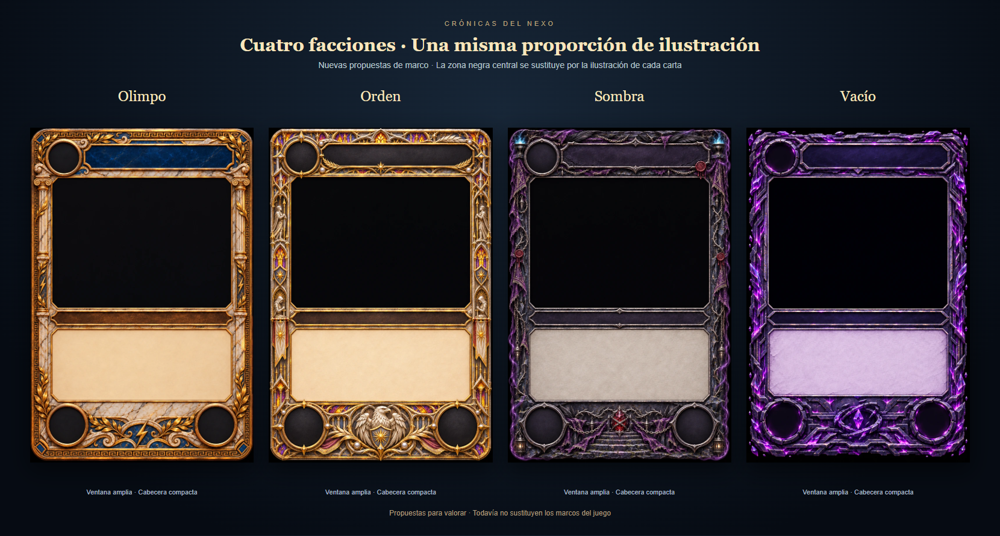

# Nuevos marcos de facción — propuestas del 5 de noviembre de 2026

Estado posterior: el propietario aprobó los cuatro diseños. Están incorporados en la rama del encargo de 32 mejoras; ver `TRABAJO-32-MEJORAS-2026-11-05.md`. Este documento conserva la comparativa y la procedencia de las propuestas originales.



## Proporciones comprobadas

Ventana central medida sobre los PNG originales de 1024 × 1536, siguiendo el campo oscuro sin invadir los biseles. Las pequeñas diferencias del contorno se ajustarán en la integración tras elegir los diseños.

| Facción | Anchura útil | Altura útil | Superficie aproximada de carta |
| --- | --- | --- | --- |
| Olimpo | 79,9 % | 38,7 % | 30,9 % |
| Orden | 79,9 % | 39,0 % | 31,2 % |
| Sombra | 80,2 % | 38,9 % | 31,2 % |
| Vacío | 80,0 % | 39,1 % | 31,3 % |

Referencia anterior: ventana de Goblins 72 % × 42 % = 30,2 % de superficie. Los nuevos diseños mantienen un área comparable y una cabecera compacta, con coste arriba a la izquierda. Los adornos conservan su detalle dentro de los bordes.

## Archivos

- Revisables versionados: `docs/propuestas/marcos-v2/olimpo.webp`, `orden.webp`, `sombra.webp`, `vacio.webp` y `comparativa.png`.
- Maestros PNG: `tools/art-inbox/propuestas-marcos-v2/<faction>-v2-propuesta.png` (solo local, ignorados por Git).
- Prompts y medidas de trabajo: `tools/art-inbox/propuestas-marcos-v2/prompts.json`, `correccion-vacio.txt` y `medidas.json`.
- Procedencia: ImageGen integrado. Referencias del propio proyecto, sin arte de terceros. Se usaron los chasis anteriores como identidad y Goblins como primera referencia de proporciones. Para Orden, Sombra y Vacío se utilizó además el nuevo Olimpo como referencia geométrica. Vacío tuvo una segunda edición para igualar la altura de ventana.

## Validación e integración pendiente

Revisión visual de los cuatro diseños y comparativa con idéntico tamaño exterior. Solo se añaden arte de propuesta y documentación, sin cambios de código ni pruebas nuevas. Tras la elección: medir bandas y estadísticas, integrar HTML y ficha 3D, comprobar legibilidad con cartas reales y en batalla a 1920 × 1080, 1366 × 768 y móvil. La generación no garantiza que el texto del juego encaje hasta completar ese trabajo.

## Prompts completos

### olimpo

```text
Create a redesigned original fantasy trading card FRAME ONLY for Crónicas del Nexo, portrait 1024x1536 (2:3), front flat orthographic, extremely detailed painterly physical craftsmanship, no readable text, no numbers, no artwork/character inside the image window. Reference image 1 is the identity/design to redesign; reference image 2 (goblin) is ONLY a functional layout/proportion guide, do not copy its gears, gauges or steampunk. CRITICAL: replace the tall bulky top crown and centered cost socket with a compact header like reference 2. Exact common functional template: one empty round cost socket centered at x=14%, y=7.5%, radius6%; a completely blank horizontal title plaque from x25% to91%, y4% to12%; a SINGLE HUGE solid near-black rectangular illustration opening from x10% to90%, y14% to56% (80% width,42% total card height), tiny bevel corners only, absolutely no ornament or internal decorations over this opening. Illustration must dominate. Border ornament stays strictly in outer10% side strips; no deep columns eating the image. A thin blank type ribbon x11%-89%, y57%-61%; a large empty light parchment rules panel x12%-88%, y63%-83%, clean low-texture for software text. Two empty dark round stat sockets centered x14%,y91% and x86%,y91%, radius7%. Narrow richly carved lower ornament between stat sockets. Preserve high detail by tiny intricate engravings and layered material finish INSIDE the narrow borders; detail density must not mean thick borders or larger ornaments. NO giant top centerpiece, NO center-top cost circle, NO image scene above the title, NO typography, NO watermarks, NO UI mockup, NO entire completed card. Full canvas opaque with black beyond slightly irregular outer edge; near-black image window opaque as in references. Keep all features functional, unobstructed.
Faction OLIMPO: ivory cracked marble, slender Greek Ionic pilasters only in edge strips, warm antique gold and bronze, fine Greek meanders, tiny carved thunderbolts, dark lapis-blue title enamel, delicate gold laurel branches at the corners and lower rim, a small thunderbolt relief between the bottom stat sockets. Celestial Greek craftsmanship, warm golden bevel highlights against cool blue marble shadows. Retain the luxurious marble-and-laurel identity of reference1 but move all the architecture to a very compact perimeter. No broad temple pediment on top.
```

### order

```text
Create a redesigned original fantasy trading card FRAME ONLY for Crónicas del Nexo, portrait 1024x1536 (2:3), front flat orthographic, extremely detailed painterly physical craftsmanship, no readable text, no numbers, no artwork/character inside the image window. Reference image 1 is the ORDER identity/design to redesign; reference image 2 is the newly redesigned OLIMPO frame and is ONLY the exact functional layout/proportion guide. Match image 2's large art window and compact header, do not copy its Greek theme, marble pillars or laurels. CRITICAL: replace the tall bulky top crown and centered cost socket with a compact header like reference 2. Exact common functional template: one empty round cost socket centered at x=14%, y=7.5%, radius6%; a completely blank horizontal title plaque from x25% to91%, y4% to12%; a SINGLE HUGE solid near-black rectangular illustration opening from x10% to90%, y14% to56% (80% width,42% total card height), tiny bevel corners only, absolutely no ornament or internal decorations over this opening. Illustration must dominate. Border ornament stays strictly in outer10% side strips; no deep columns eating the image. A thin blank type ribbon x11%-89%, y57%-61%; a large empty light parchment rules panel x12%-88%, y63%-83%, clean low-texture for software text. Two empty dark round stat sockets centered x14%,y91% and x86%,y91%, radius7%. Narrow richly carved lower ornament between stat sockets. Preserve high detail by tiny intricate engravings and layered material finish INSIDE the narrow borders; detail density must not mean thick borders or larger ornaments. NO giant top centerpiece, NO center-top cost circle, NO image scene above the title, NO typography, NO watermarks, NO UI mockup, NO entire completed card. Full canvas opaque with black beyond slightly irregular outer edge; near-black image window opaque as in references. Keep all features functional, unobstructed.
Faction ORDEN: sacred knightly high fantasy, burnished antique GOLD and IVORY steel, tiny amber and violet stained-glass fragments in narrow gothic edge tracery, miniature carved guardian knights in the slender side border, small pearl settings, dark charcoal title plaque with gilt feather engraving on its rim. Retain the eagle symbolism but place a compact white eagle bas-relief with folded wings ONLY in the lower central space between the two stat sockets. NO huge eagle at top, NO broad wings over header or image. Narrow detailed gold feather trims on the edges, sunburst micro-engravings, rich metallic layering, warm sunlit edge highlights and cool blue steel shadows. Parchment ivory cream. The large illustration window must begin as high as in reference2 and occupy the same exact area; top must remain compact despite dense microdetail.
```

### shadow

```text
Create a redesigned original fantasy trading card FRAME ONLY for Crónicas del Nexo, portrait 1024x1536 (2:3), front flat orthographic, extremely detailed painterly physical craftsmanship, no readable text, no numbers, no artwork/character inside the image window. Reference image 1 is the SOMBRA identity/design to redesign; reference image 2 is the newly redesigned OLIMPO frame and is ONLY the exact functional layout/proportion guide. Match image 2's large art window and compact header. Do not copy its Greek theme, gold, marble pillars or laurels. CRITICAL: replace the tall bulky top crown and centered cost socket with a compact header like reference 2. Exact common functional template: one empty round cost socket centered at x=14%, y=7.5%, radius6%; a completely blank horizontal title plaque from x25% to91%, y4% to12%; a SINGLE HUGE solid near-black rectangular illustration opening from x10% to90%, y14% to56% (80% width,42% total card height), tiny bevel corners only, absolutely no ornament or internal decorations over this opening. Illustration must dominate. Border ornament stays strictly in outer10% side strips; no deep columns eating the image. A thin blank type ribbon x11%-89%, y57%-61%; a large empty light parchment rules panel x12%-88%, y63%-83%, clean low-texture for software text. Two empty dark round stat sockets centered x14%,y91% and x86%,y91%, radius7%. Narrow richly carved lower ornament between stat sockets. Preserve high detail by tiny intricate engravings and layered material finish INSIDE the narrow borders; detail density must not mean thick borders or larger ornaments. NO giant top centerpiece, NO center-top cost circle, NO image scene above the title, NO typography, NO watermarks, NO UI mockup, NO entire completed card. Full canvas opaque with black beyond slightly irregular outer edge; near-black image window opaque as in references. Keep all features functional, unobstructed.
Faction SOMBRA: ritual dusk, blackened silver and charcoal ruined stone, richly embroidered ragged violet velvet strips confined to the narrow edges, tiny raven feathers, small hanging chains, minute red wax seals, delicate bramble engraving. Small spectral cyan braziers in the two extreme top corners, no tall altar skyline. Dark desaturated purple slate title plaque, blackened silver cost and stat bezels. An intricate tiny blood-red crystal on a compact stair altar in the lower central space between stat sockets, draped in violet cloth, miniature lanterns at the very bottom corners. Empty rules parchment must be pale warm ash-grey, clean and readable. Cool moonlit blue edge highlights, purple luminous vapour hugging the OUTSIDE edges only, deep indigo shadows. Original realistic dark fantasy, exquisite tangible materials, haunted cloister identity, no skull face filling the layout. The illustration window is exactly as large as reference2. No huge top shrine, no centered top socket, no cloth crossing image.
```

### void

```text
Create a redesigned original fantasy trading card FRAME ONLY for Crónicas del Nexo, portrait 1024x1536 (2:3), front flat orthographic, extremely detailed painterly physical craftsmanship, no readable text, no numbers, no artwork/character inside the image window. Reference image 1 is the VACIO identity/design to redesign; reference image 2 is the newly redesigned OLIMPO frame and is ONLY the exact functional layout/proportion guide. Match image 2's large art window and compact header. Do not copy its Greek theme, gold, marble pillars or laurels. CRITICAL: replace the tall bulky top crown and centered cost socket with a compact header like reference 2. Exact common functional template: one empty round cost socket centered at x=14%, y=7.5%, radius6%; a completely blank horizontal title plaque from x25% to91%, y4% to12%; a SINGLE HUGE solid near-black rectangular illustration opening from x10% to90%, y14% to56% (80% width,42% total card height), tiny bevel corners only, absolutely no ornament or internal decorations over this opening. Illustration must dominate. Border ornament stays strictly in outer10% side strips; no deep columns eating the image. A thin blank type ribbon x11%-89%, y57%-61%; a large empty light parchment rules panel x12%-88%, y63%-83%, clean low-texture for software text. Two empty dark round stat sockets centered x14%,y91% and x86%,y91%, radius7%. Narrow richly carved lower ornament between stat sockets. Preserve high detail by tiny intricate engravings and layered material finish INSIDE the narrow borders; detail density must not mean thick borders or larger ornaments. NO giant top centerpiece, NO center-top cost circle, NO image scene above the title, NO typography, NO watermarks, NO UI mockup, NO entire completed card. Full canvas opaque with black beyond slightly irregular outer edge; near-black image window opaque as in references. Keep all features functional, unobstructed.
Faction VACÍO: original ominous cosmic fantasy, shattered dark obsidian and slate shards, angular thin layered stone rim with minute silver seams, luminous amethyst crystals and violet fissures restricted to outer perimeter, tiny levitating crystal fragments around the outer silhouette. No gigantic top portal or broad rings consuming the art. Empty upper-left cost socket and bottom two stat sockets are dark black-purple circles surrounded by narrow fractured-stone bezels with restrained glowing violet inner rims. Blank dark indigo title slab. A small intricate fractured orbital ring with one levitating violet crystal ONLY between the lower stat sockets, tiny broken masonry steps. Narrow edge framework dense with crystalline facets, sharp fine engravings and impossible interlocking stone, high physical texture detail. Empty rules parchment pale desaturated lavender-grey with a clean light central field, dark text will be placed by software. Deep midnight blue shadows and sharp violet-white refracted bevel light, dramatic original dark fantasy. The illustration opening must exactly match the size of reference2, no crystals, portal rings, spikes or fog encroaching inside it. Compact header, no central top circle.
```

### Corrección final de Vacío

```text
Edit reference image 1, the new VACÍO fantasy card frame, preserving its exact obsidian/violet crystal material, tiny details, color, upper-left cost socket and compact title. Reference image 2 OLIMPO is ONLY an exact geometry template, never copy its Greek materials or symbols. CORRECT the image1 layout so the central near-black art opening has the SAME HEIGHT as image2: on a 1024x1536 canvas the empty art opening is x102 to921, y230 to826. The current image1 opening ends too high around y795; extend it DOWN to y826. The thin blank type ribbon consequently sits from y844 to910, and the pale lavender empty rules parchment from y930 to1254. Bottom empty stat sockets centered near x150,y1370 and x870,y1370. Keep both side edges narrow and straight so all that large rectangle is unobstructed and plain near-black. Keep the same dense crystalline edge details and narrow silver seams, keep the small orbital amethyst crystal at the bottom between the stat sockets. Do not move the title down, do not add a giant central top cost socket, do not thicken borders. Keep the original rich dark fantasy painterly physical craftsmanship, no text, letters, numbers or illustration inside the art opening. Portrait 2:3 1024x1536, full opaque canvas, no watermark. This is a strictly geometry correction of image1 to match image2's functional template.
```
